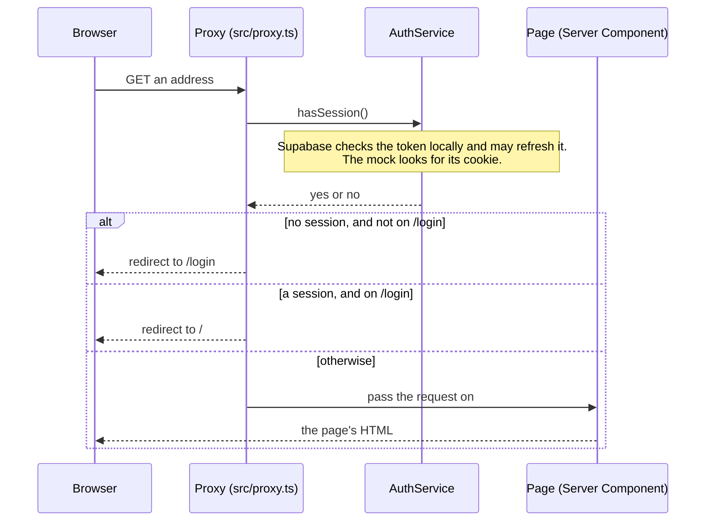
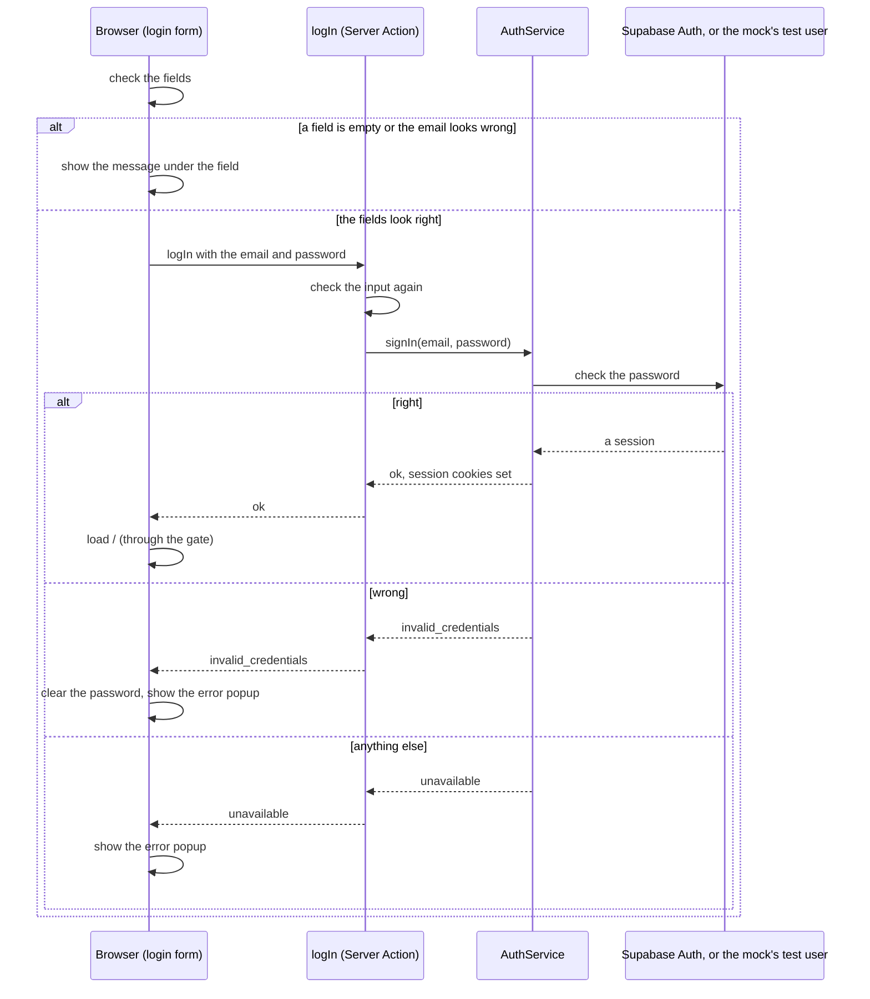
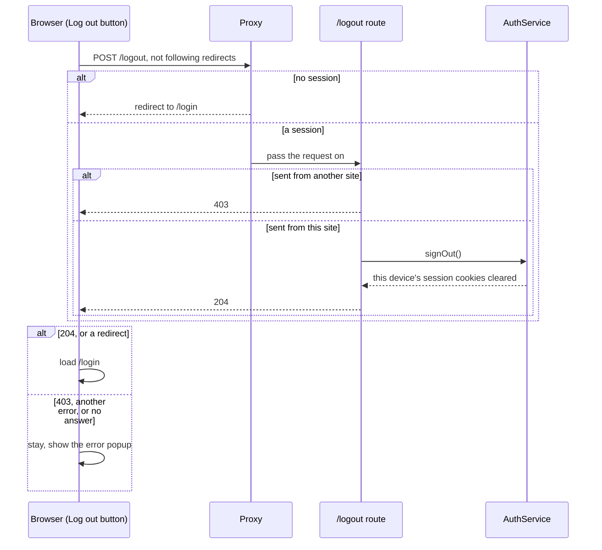

# Architecture

💡 How the app is built: where each piece of code runs, what lives in each folder, and how a request moves through the app. It describes `main` as it is today. For the code, follow the links. For why a choice was made, follow the ADRs.

Read it before adding code in a new area. When a change alters what this page describes, update the page in the same pull request.

## Where code runs

The app is built with Next.js ([ADR 0009](decisions/0009-build-with-nextjs.md)). In Next.js, a file's name and the marker at its top decide whether its code runs on the server or in the visitor's browser.

| File or marker | Runs | When | Here |
| --- | --- | --- | --- |
| `proxy.ts` | Server | Before every request except Next.js's own files and the icons, ahead of any page or route | [`src/proxy.ts`](../../src/proxy.ts), the gate |
| `route.ts` | Server | When a request arrives at its address, one function per HTTP method | [`src/app/logout/route.ts`](../../src/app/logout/route.ts), `POST /logout` |
| A file starting with `"use server"` | Server | When browser code calls one of its functions (a Server Action) | [`src/app/login/actions.ts`](../../src/app/login/actions.ts), `logIn` |
| `page.tsx`, `layout.tsx` | Server, by default | Prerendered when the app is built. A part that reads the request runs when the page is opened | [`src/app/page.tsx`](../../src/app/page.tsx), [`src/app/login/page.tsx`](../../src/app/login/page.tsx), [`src/app/layout.tsx`](../../src/app/layout.tsx) |
| A file starting with `"use client"` | Browser, after the server renders it first | When the visitor clicks or types | [`src/app/login/login-form.tsx`](../../src/app/login/login-form.tsx), [`src/components/logout-button.tsx`](../../src/components/logout-button.tsx) |

Some details that matter:

- **The proxy runs on Node.js.** In Next.js 16, Proxy replaced Middleware and runs on Node.js by default.
- **Cache Components is on**, in [`next.config.ts`](../../next.config.ts). Next.js prerenders each page's HTML shell when the app is built, and a part that reads the request, such as its cookies or per-user data, runs on each request. That part belongs inside `<Suspense>`, as Next.js's Caching guide explains. The 404 page stays fully static on purpose: see the comment in [`not-found.tsx`](../../src/app/not-found.tsx).
- **A Server Action is a public endpoint.** The browser calls it with a POST, so anyone can call it with any values. `logIn` checks its input again before trusting it.
- **Files that aren't marked go where they're imported.** A component with no marker that's imported only by pages runs on the server. A helper such as [`validate-login.ts`](../../src/lib/auth/validate-login.ts) runs in both places: the login form checks the fields in the browser, and `logIn` checks them again on the server.
- **`import "server-only"`** at the top of a file makes the build fail if browser code imports it. The auth files that build the service, hold the Supabase client or read the request's cookies use it (listed under [The auth module](#the-auth-module)).
- **Variables stay on the server.** Next.js puts a variable into browser code only if its name starts with `NEXT_PUBLIC_`. None of ours does.

If you know backend frameworks, these are the closest familiar terms:

| Here | Familiar term |
| --- | --- |
| The proxy | Middleware, or a guard in front of every route |
| A route handler (`route.ts`) or a Server Action | Controller |
| `AuthService` and `CookieJar` | Service interfaces (ports) |
| The Supabase and mock auth services | Providers (adapters) of one interface |
| `createAuthService` | Factory |

## The folder map

| Folder | What belongs there |
| --- | --- |
| [`src/proxy.ts`](../../src/proxy.ts) | The gate: one file, run before every request except Next.js's own files and the icons |
| [`src/app/`](../../src/app/) | The addresses: one folder per address, holding its page, route or Server Actions and the components only it uses. Also the root layout, the 404 page, the icons and `globals.css` |
| [`src/components/`](../../src/components/) | Components shared by several pages, such as the header and the log out button |
| [`src/components/ui/`](../../src/components/ui/) | Components generated by shadcn/ui with `npx shadcn add` ([ADR 0012](decisions/0012-keep-the-design-system-in-code.md)) |
| [`src/lib/`](../../src/lib/) | Code with no screen of its own: the auth module in `auth/`, the text the screens show in `messages/`, and small helpers |
| `__tests__/` | Unit tests, next to the code they test, one file per file |
| [`e2e/`](../../e2e/) | End-to-end tests, one spec per area ([ADR 0015](decisions/0015-test-screens-end-to-end-with-playwright-in-ci.md)) |
| [`supabase/`](../../supabase/) | The settings for the temporary Supabase that CI starts ([ADR 0019](decisions/0019-test-login-against-a-temporary-supabase-in-ci.md)) |

## The auth module

[`src/lib/auth/`](../../src/lib/auth/) is everything about sessions. The rest of the app knows only two interfaces, defined in [`types.ts`](../../src/lib/auth/types.ts):

- **`AuthService`**, what the app asks: `hasSession()`, `signIn(email, password)` and `signOut()`. A failed sign-in returns only a code, `invalid_credentials` or `unavailable`, never the login service's own text.
- **`CookieJar`**, where the service reads and writes the session cookies: `getAll()` and `setAll(cookies, headers)`.

There are two implementations of `AuthService`:

- **Supabase**, in [`supabase.ts`](../../src/lib/auth/supabase.ts). It checks passwords with Supabase Auth ([ADR 0016](decisions/0016-use-supabase-for-authentication.md)). `hasSession()` checks the session token locally and can refresh it, which writes new cookies. If either of its two variables is missing, it logs that once and acts as if the login service were down.
- **The mock**, in [`mock.ts`](../../src/lib/auth/mock.ts). It knows one invented user, from [`test-user.ts`](../../src/lib/auth/test-user.ts), and keeps the session in a cookie of its own. It refuses to start when `APP_ENV` or `VERCEL_ENV` is `production`.

**`createAuthService`**, in [`index.ts`](../../src/lib/auth/index.ts), builds one of them for a request. [`pickAuthBackend`](../../src/lib/auth/backend.ts) reads `APP_ENV` to choose ([ADR 0018](decisions/0018-pick-the-auth-service-with-app-env.md)). Both use the same cookie options, from [`cookie-options.ts`](../../src/lib/auth/cookie-options.ts).

Every caller gives the service a jar for the current request:

- **The proxy** builds its own jar. Cookies the service writes go onto the request, so the page sees them, and onto the response, so the browser keeps them.
- **Server Actions and routes** use [`authServiceForRequest`](../../src/lib/auth/next-cookie-jar.ts), whose jar uses Next.js's `cookies()`.

Server-only: `index.ts`, `supabase.ts` and `next-cookie-jar.ts`. The browser imports only `types.ts` and `validate-login.ts`.

## The three flows

### Opening a page

Every request goes through the gate first, including the POSTs from the login form and the log out button. Only Next.js's own files and the icons skip it (see the last point below).

- [`routeFor`](../../src/proxy.ts) holds the rule: only `/login` is open without a session, and a visitor who is logged in never sees it.
- Every response from the gate says `Cache-Control: private, no-store`, so no cache keeps a page that belongs to a session.
- A page that the browser restores from its back/forward cache skips the server. [`BfcacheReload`](../../src/components/bfcache-reload.tsx), in the root layout, reloads it so the gate decides again.
- Next.js's own files (`/_next/static/`, `/_next/image`) and the three icons skip the gate. The proxy's `matcher` lists them.

### Logging in

- The form is [`login-form.tsx`](../../src/app/login/login-form.tsx), and the action is [`actions.ts`](../../src/app/login/actions.ts).
- After a login, the browser loads `/` as a full page, so the gate sees the new cookies.
- Rate limits, network errors and a missing variable all come back as `unavailable`. Only a wrong email or password is the user's to fix.
- If the page is from an older build, the server no longer knows its action. The form then reloads the page instead of showing an error.
- The text of each message is in [`messages/auth.ts`](../../src/lib/messages/auth.ts).

### Logging out

- The button is [`logout-button.tsx`](../../src/components/logout-button.tsx), and the route is [`logout/route.ts`](../../src/app/logout/route.ts).
- Logging out is a route at one fixed address, not a Server Action, so it works from every page, the 404 page included. The route's comment explains why.
- The route exports only `POST`. Next.js answers any other method except `OPTIONS` with 405, so a link or a prefetch can't end the session.
- A redirect means the session was already gone, for example after logging out in another tab. That counts as logged out.
- `signOut()` clears only this device's session, and it clears the cookies even when Supabase can't be reached.

## Adding a new area

When business data arrives, such as matches, a new area follows the auth module's shape. Nothing below exists yet. It's the pattern to follow.

- **A module in `src/lib/<area>/`**, for example `src/lib/matches/`:
  - a port in `types.ts`, the interface the rest of the app uses, such as a `MatchService`;
  - a Supabase adapter, server-only;
  - a factory that builds it for the current request, like `createAuthService`;
  - a mock adapter too, picked by `APP_ENV`, if previews and local runs need the area without Supabase ([ADR 0018](decisions/0018-pick-the-auth-service-with-app-env.md)).
- **The session check next to the data.** The gate checks the session token locally, so a user removed in Supabase keeps access until the token expires, up to an hour. ADR 0018 requires the first Feature that reads per-user data to check with Supabase directly, in the same server code that reads the data, so a removed user gets no data. Never rely on the gate alone.
- **Screens in `src/app/<area>/`.** Pages read data on the server, through the module. The part that reads it sits inside `<Suspense>`, because Cache Components is on (see [Where code runs](#where-code-runs)). Browser code calls a Server Action or a route, never the module directly.
- **Text in `src/lib/messages/<area>.ts`**, and tests in `__tests__/` next to each file, plus an `e2e/<area>.spec.ts`.
- **This page**, updated in the same pull request.

## Environments

`APP_ENV` is read only on the server, when a request arrives. It decides which auth service runs. The same build works everywhere.

| `APP_ENV` | Where | Set by | Auth service |
| --- | --- | --- | --- |
| `local` | `npm run dev`, and the end-to-end tests on a laptop | `.env.local`, copied from [`.env.example`](../../.env.example) | Mock |
| `preview` | Each pull request's Vercel preview | Vercel's Preview environment | Mock |
| `test` | The end-to-end tests in CI | The CI workflow, against a temporary Supabase | Supabase |
| `production` | The live app on Vercel | Vercel's Production environment | Supabase |
| missing or unknown | Wherever it was forgotten or misspelled | Nobody | Supabase, the safe side |

Production runs in Frankfurt: Vercel's functions in `fra1`, set in [`vercel.json`](../../vercel.json), and the Supabase project in Supabase's Central EU (Frankfurt) region.

The decisions behind it:

- [ADR 0016](decisions/0016-use-supabase-for-authentication.md): why Supabase, and its project settings
- [ADR 0017](decisions/0017-run-in-the-eu-in-frankfurt.md): why Frankfurt
- [ADR 0018](decisions/0018-pick-the-auth-service-with-app-env.md): why `APP_ENV`, and why a mock outside production
- [ADR 0019](decisions/0019-test-login-against-a-temporary-supabase-in-ci.md): why CI logs in against a temporary Supabase

## Where next

- 💡 [Decisions (ADRs)](decisions/README.md)
- ⬆️ [Explanation](README.md)
- 🏠 [Docs home](../README.md)
