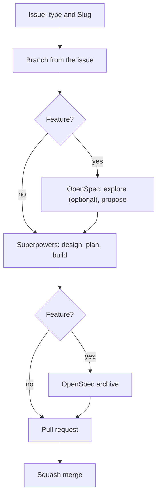

# How to take a change from idea to merge

This guide walks one change from an idea to a merged pull request. The rules themselves live in [AGENTS.md](../../AGENTS.md), and they apply to people and coding agents alike. This page puts them in order.

## The flow



## Steps

1. **Open an issue.** Pick its type (see [Feature, Task and Bug](#feature-task-and-bug)) and fill in its form, including the Slug. An agent drafts the title, type and body, shows them to the repository owner, and then runs:

   ```bash
   gh issue create --type <Type> --title "…" --body-file <file> --assignee @me
   ```

2. **Create the branch from the issue.** Start from an up-to-date `main`. After the owner agrees, create the branch from the issue, named after the [change key](#the-change-key), so GitHub links them. Then check that you're on it:

   ```bash
   git switch main && git pull
   gh issue develop <number> --name <key> --checkout
   git branch --show-current
   ```

3. **Features: write the business change.** Describe the new behavior as an OpenSpec change named after the change key. One active change at a time, across the whole repo: never two Feature branches with an open OpenSpec change.
   1. *Optional:* run `/opsx:explore` to settle open business questions first.
   2. Run `/opsx:propose` with the change key as the change name. It writes the proposal, specs, design and tasks, all in business language.
   3. The owner reviews the proposal, specs, design and tasks before anything is built.
4. **Design, plan and build with Superpowers.** For a Feature, start with `/opsx:apply`, which hands the change to Superpowers. Superpowers saves the design and the plan in `superpowers/<key>/design.md` and `plan.md`, and asks the owner to approve each one before going on. If the change involves a significant technical choice, add an ADR (see [Decisions](../explanation/decisions/README.md)).
5. **Features: archive the OpenSpec change** with `/opsx:archive`, so the spec describes what the app now does. Commit the archive on its own, after all other commits, as the last commit before the pull request. Then run `openspec validate --specs`, and the owner reviews the `openspec/specs/` diff.
6. **Commit.** Write the message as a Conventional Commit (see the Commits section of [AGENTS.md](../../AGENTS.md)).
7. **Open the pull request.** Before opening the PR, tick each 'Done when' item in the issue (the Acceptance criteria, for a Feature) that the change meets (with `gh issue edit`), and note in the PR body how each was checked. Don't merge with unticked items: finish them or remove them with a reason. Ask the owner before pushing and before opening it. Use the pull request template, and link the issue with `Closes #<issue-number>`. Once CI exists, a check confirms that the branch, the Superpowers folder and the OpenSpec change all use the issue's key.
8. **Squash-merge** once the pull request checklist is complete. The issue closes on its own.

## Feature, Task and Bug

| Type | When | Path |
| --- | --- | --- |
| **Feature** | It changes what the app does: its business spec changes. | Issue → branch → OpenSpec change → Superpowers → OpenSpec archive → PR → merge |
| **Bug** | The app doesn't do what its spec says. | Issue → branch → Superpowers → PR → merge |
| **Task** | Everything else: the spec doesn't change, and there's no defect. | Issue → branch → Superpowers → PR → merge |

A Bug skips OpenSpec because the spec is already right: the fix brings the app back in line with it.

## The change key

Every change has one key, `<issue-number>-<slug>`. The slug comes from the issue's Slug field: 2–4 words, in kebab-case. Once the branch exists, read the key from it with `git branch --show-current` instead of typing it again.

Never rename the branch. If the key is wrong, delete the branch and recreate it before any work starts. If the slug is what's wrong, fix the issue's Slug first.

| Where | Example for Feature #20, Slug `clash-days` |
| --- | --- |
| Branch | `20-clash-days` |
| Superpowers folder | `superpowers/20-clash-days/` |
| OpenSpec change | `openspec/changes/20-clash-days/` |

One search for the key finds everything about a change. Why we work this way: [ADR 0006](../explanation/decisions/0006-one-key-per-change.md).

## Big work

Split the work when it has more than one independently useful outcome, won't fit in one reviewable pull request, or touches several independent parts.

1. Open a parent issue. It gets no branch and no pull request. A parent issue takes the type of its overall outcome: Feature if the work as a whole changes what the app does, otherwise Task. Its Slug names the overall work, but no branch uses it.
2. Create each sub-issue under it:

   ```bash
   gh issue create --parent <number> --type <Type> --title "…" --body-file <file> --assignee @me
   ```

3. Take each sub-issue through the normal flow. Its pull request closes only that sub-issue.
4. Close the parent by hand when the last sub-issue's pull request merges.

## The gh version

`gh issue create --type` and `--parent` need a recent gh CLI. gh 2.45.0 doesn't have them, but 2.102.0 does. To check yours, run `gh issue create --help`.

## Where next

- 📋 The rules: [AGENTS.md](../../AGENTS.md)
- 💡 Why one key per change: [ADR 0006](../explanation/decisions/0006-one-key-per-change.md)
- 💡 Why business specs with OpenSpec: [ADR 0007](../explanation/decisions/0007-write-business-specs-with-openspec.md)
- ⬆️ [How-to guides](README.md)
- 🏠 [Docs home](../README.md)
