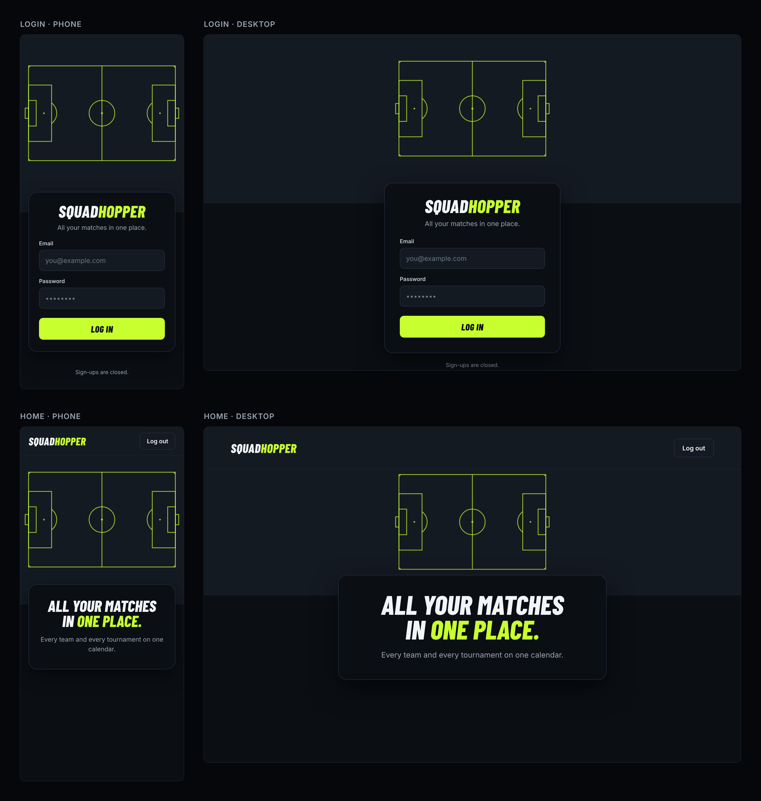

# Design guide

How the app looks, and how to build a screen that matches. The look is called "Night pitch": a dark page, a football pitch drawn in volt lines across the top of the screen, and a card that overlaps it.

This page describes the code. The theme lives in [`src/app/globals.css`](../../src/app/globals.css) and the shared pieces in [`src/components/`](../../src/components/). They are the source of truth: if this guide and the code ever disagree, the code wins and this guide gets fixed. Why the app has one dark theme: [ADR 0014](../explanation/decisions/0014-ship-one-dark-theme.md).

## Tokens

Use these through their Tailwind classes. Never write the value itself in a screen.

### Colors

| Token | Value | Tailwind class | When to use it |
| --- | --- | --- | --- |
| `background` | `#0B0F14` | `bg-background` | The page behind everything. Set on `<body>`, so screens rarely need it |
| `card` | `#0B0F14` | `bg-card` | Cards. Same as the page, so a card stands out through its border and shadow |
| `surface` | `#141A22` | `bg-surface` | The header, the pitch band and inputs: the lighter, raised areas |
| `popover`, `muted`, `secondary` | `#141A22` | `bg-popover`, `bg-muted`, `bg-secondary` | Floating menus, subtle fills and low-emphasis buttons (used by shadcn/ui components) |
| `foreground` | `#F2F5F7` | `text-foreground` | Normal text |
| `card-foreground`, `popover-foreground`, `secondary-foreground`, `accent-foreground` | `#F2F5F7` | `text-card-foreground` and so on | Text on cards, menus, low-emphasis buttons and hover backgrounds (used by shadcn/ui components) |
| `muted-foreground` | `#9AA4B2` | `text-muted-foreground` | Secondary text: lead text, hints, small print |
| `primary` (volt) | `#C8FF2E` | `text-primary`, `bg-primary`, `stroke-primary` | **Only** the pitch lines, highlighted words and the main button. Never links, focus rings or borders |
| `primary-foreground` | `#0B0F14` | `text-primary-foreground` | Text on volt, such as the main button's label |
| `border`, `input` | `#263040` | `border-border`, `border-input` | Card and input borders |
| `divider` | `#1B2430` | `border-divider` | The lines under the header and the pitch band |
| `accent` | `#1B2430` | `bg-accent` | Hover and focus backgrounds (shadcn/ui's meaning of "accent", not volt) |
| `ring` | `#9AA4B2` | `ring-ring`, `outline-ring` | Focus rings. Grey, so focus is visible without using volt |
| `destructive` | `oklch(0.704 0.191 22.216)` | `text-destructive`, `bg-destructive` | Errors and destructive actions |

### Hex values outside the theme

Two files write palette values directly, because they can't read CSS variables. If `--surface` or `--primary` changes in `globals.css`, change these too, in the same pull request. Screens still never write hex values.

| File | Values | Why |
| --- | --- | --- |
| `src/app/icon.svg` (the favicon) | `#141A22` (surface), `#C8FF2E` (primary) | An SVG file served as an icon can't read the page's CSS variables |
| `src/app/layout.tsx` (`viewport.themeColor`) | `#141A22` (surface) | The `theme-color` meta tag, which colors the bar above the page in phone browsers that support it, takes a color value, not a CSS variable |

### Fonts

| Token | Font | Tailwind class | When to use it |
| --- | --- | --- | --- |
| `sans` | Inter | `font-sans` | Everything except headings. It's the page default, so you rarely write it |
| `heading` | Barlow Condensed, extra-bold italic | `font-heading italic font-extrabold` | Page titles and the wordmark. Always uppercase |

Both fonts are self-hosted with `next/font` and wait briefly before showing text (`display: "block"`), so there's no flash of a fallback font. Only Barlow Condensed's extra-bold italic is loaded, so always write `font-heading` with `italic font-extrabold`.

### Radius

| Token | Value | Tailwind class | When to use it |
| --- | --- | --- | --- |
| `radius` | 10 px | `rounded-lg` | Inputs and buttons |
| derived (`radius × 1.8`) | 18 px | `rounded-2xl` | Cards |

Spacing and shadows use Tailwind's defaults: spacing in 4 px steps (`p-4` is 16 px), and `shadow-2xl` for cards.

## Type scale

Phone sizes apply below 768 px. The `md:` sizes apply from 768 px up.

| Kind of text | Classes |
| --- | --- |
| Page title | `font-heading text-4xl leading-none font-extrabold italic uppercase md:text-6xl` |
| Wordmark in the header | the `Wordmark` component (`font-heading text-2xl … md:text-3xl`) |
| Lead text under a page title | `text-sm text-muted-foreground md:text-lg` |
| Body text | `text-base` |
| Small print | `text-xs text-muted-foreground` |

Highlight a few words of a page title with `<span className="text-primary">`, as in "All your matches in **one place.**".

## Page layout

Every page has the same frame:

- **The top half of the screen is the surface color.** It holds the header (on pages that have one) and the pitch band. On short screens, such as a phone in landscape, the surface grows past half, just enough to keep the pitch about 96 px tall.
- **The pitch** is centered in the band and grows with it. Its area takes about 80% of the band's free height, and the pitch fills it as far as its width allows, up to 960 px wide. It shrinks to fit narrow phones and short screens, so it's never cropped, but never below about 96 px tall. The space above it always equals the space between it and the card.
- **The card** sits centered below, overlapping the band by 48 px. On phones it has 20 px margins; on desktop the page sets its width (the home card is at most 640 px wide).

The pitch's maximum width (960 px) belongs to the page frame, not to any card. If a card gets much wider, check the pitch on a large screen and raise the cap in the same change if needed.

`PitchLayout` builds this frame, so a screen only supplies the header and the card:

```tsx
import { AppHeader } from "@/components/app-header";
import { PitchLayout } from "@/components/pitch-layout";
import { Card } from "@/components/ui/card";

export default function Page() {
  return (
    <PitchLayout header={<AppHeader />}>
      <Card className="w-full rounded-2xl border border-border shadow-2xl ring-0 md:max-w-160">
        …
      </Card>
    </PitchLayout>
  );
}
```

Leave out `header` for a page without one, such as the login screen. `AppHeader` shows the `Wordmark` as a link to the home page and takes actions (such as a Log out button) as children.

`PitchLayout` uses one bracket value, `min-h-[50svh]`, because Tailwind has no class for "at least half the screen height". It lives only in that component. It's a minimum, not a fixed height, so the surface can grow on short screens in every browser, Safari included. It uses `svh`, not `dvh`, so the band and the pitch don't jump while a phone's address bar slides. Screens never write it.

## Do and don't

| Do | Don't | Why |
| --- | --- | --- |
| `text-primary` | `text-[#C8FF2E]`, `text-lime-400` | The token keeps one source for the color; the others drift from it |
| `text-4xl` | `text-[38px]` | Sizes come from Tailwind's scale, so screens stay consistent |
| `p-6`, `gap-4` | `p-[22px]` | Spacing comes from the 4 px scale |
| `rounded-2xl` on cards | `rounded-[20px]` | Radius comes from the theme's scale |
| `border-border` or `border-divider` | `border-primary` | Volt is only for pitch lines, highlighted words and the main button |
| `text-foreground underline` for links | `text-primary` for links | Same rule: links aren't one of volt's three uses. The header's wordmark is the one link without an underline: it looks like the logo, and keyboard focus shows the grey `ring` |
| `font-heading italic font-extrabold` | `font-heading` alone | Only the extra-bold italic is loaded; anything else is faked by the browser |
| `<PitchLayout>` for a page's frame | Rebuilding the band and overlap in a screen | One component keeps every page's layout the same |

## App icons

The icon is a surface square with a small pitch in volt lines. Next.js finds three files in `src/app/` and adds their `<link>` tags itself:

| File | Used by |
| --- | --- |
| `icon.svg` | Browser tabs, in browsers that show SVG favicons. It's the source the other two are drawn from |
| `favicon.ico` | Browsers that don't show SVG favicons, such as Safari before version 26, and anything that asks for `/favicon.ico`. It holds 16, 32 and 48 px images |
| `apple-icon.png` | "Add to Home Screen" on iPhone and iPad, at 180 × 180 px. It's a full square with no rounded corners or transparency, because iOS rounds the corners itself and turns transparent pixels black |

If `icon.svg` changes, redraw the other two from it in the same pull request, for example with `sharp`, which Next.js already installs. `src/app/__tests__/icons.test.ts` checks their sizes.

## Need a new value?

If a screen needs a color, font or other value the tokens don't cover, add it as a token to `src/app/globals.css` and add a row to this guide, in the same pull request. Don't write the value into the screen.

## The picture



This is the picture the owner chose the look from, before any code was written. It records the look, not any screen's spec ([ADR 0013](../explanation/decisions/0013-design-screens-in-code.md)). Its pixel sizes were picked by hand and were snapped to Tailwind's scale in the code, so where the picture and the code differ, the code wins. The login screen in it is built by the login Feature.

## Where next

- 🛠️ How screens are designed and reviewed: [Screen design](../how-to/development-workflow.md#screen-design)
- 💡 Why one dark theme: [ADR 0014](../explanation/decisions/0014-ship-one-dark-theme.md)
- 💡 Why the design system lives in code: [ADR 0012](../explanation/decisions/0012-keep-the-design-system-in-code.md)
- ⬆️ [Reference](README.md)
- 🏠 [Docs home](../README.md)
