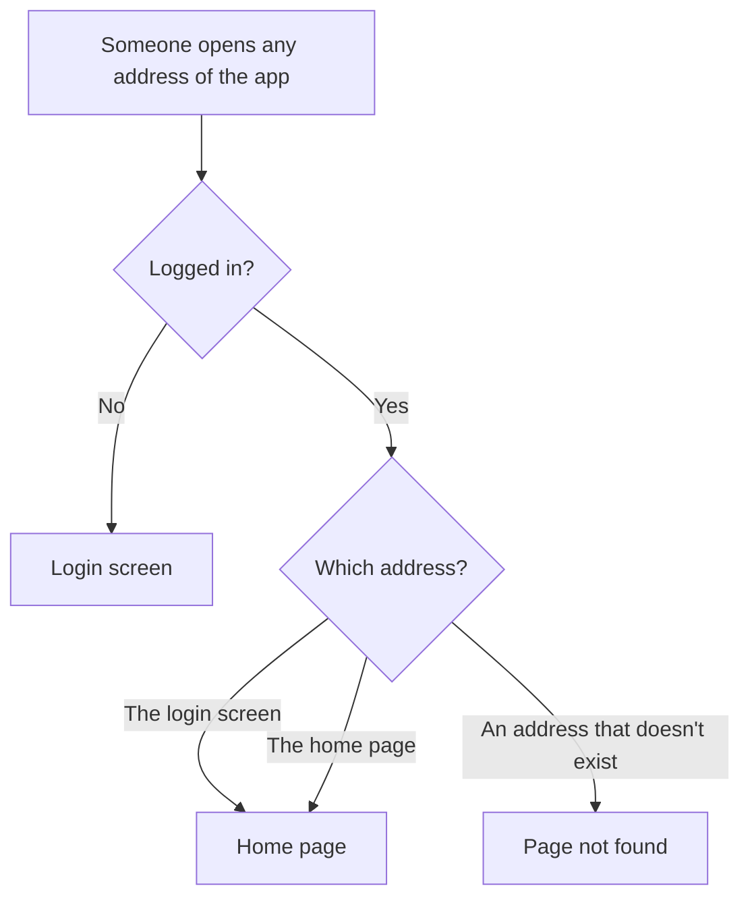
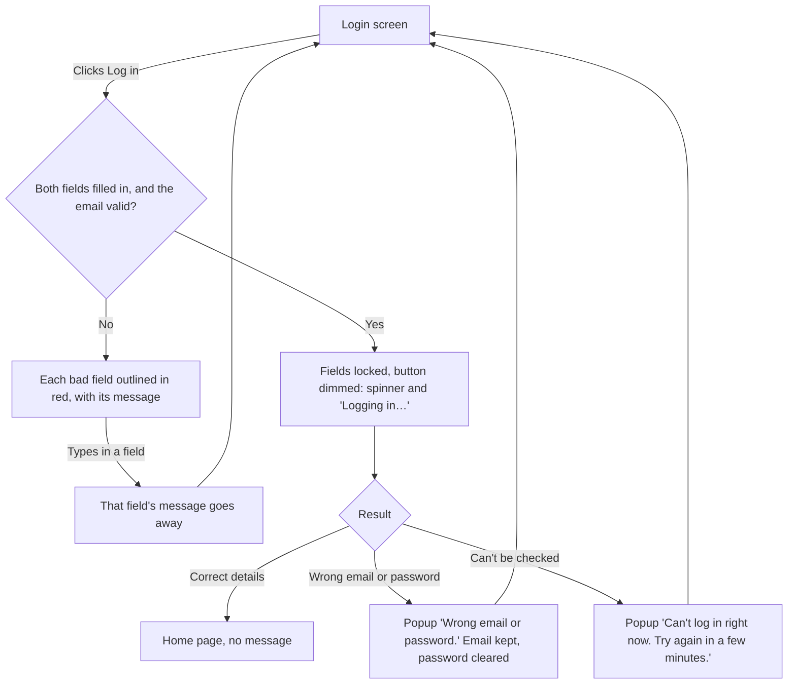
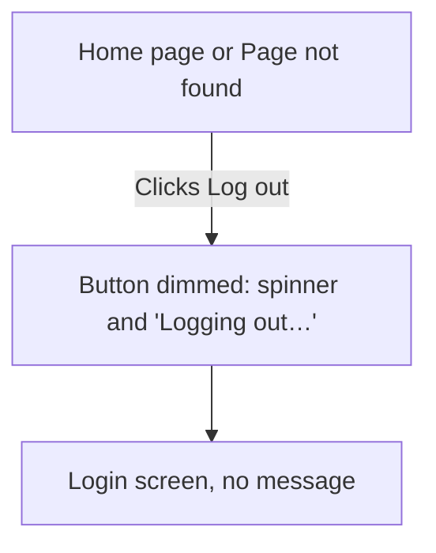

# Design

## Context

Today the app has two screens, the home page and the "page not found" page, and anyone can open both (see proposal.md, Why). This change puts a login screen in front of them and adds a Log out button to their header. Users exist only because the owner adds them by hand; nobody can sign up.

The look was agreed with the owner on design boards attached to the issue: the login screen, the home page and the "page not found" page at phone (390 px) and desktop (1280 px) widths, with their empty-field, logging-in, error and logging-out states. The boards record the look, not a spec. Where they and the design guide differ, the design guide wins.

## Goals / Non-Goals

**Goals:**

- Keep everything in the app away from people who aren't logged in.
- Make logging in quick for a user who knows their details, and clear for one who doesn't: every failure says what to do next, in plain words.
- Give later features one error popup to reuse.

**Non-Goals:**

- Sign-up, password reset and a "show password" button.
- Logging out on every device at once.
- Success or info popups ("Logged in", "Logged out").
- Translations of the texts; a later change moves them into translatable messages.
- What the app does when the login service has been paused for a long time.

## Screens

| Screen | Who sees it | What's on it |
| --- | --- | --- |
| Login | Anyone not logged in, at any address | A card in the pitch band's overlap with the wordmark, the tagline, Email, Password and the Log in button, and the small print "Sign-ups are closed." under the card. No header |
| Home | Logged-in users | As today, plus a Log out button at the right of the header |
| Page not found | Logged-in users, at an address that doesn't exist | As today, plus a Log out button at the right of the header |
| Error popup | Over any screen, when something fails | Error icon, message, close (×) button |

## Flows

### Opening the app

### Logging in

### Logging out

## Decisions

- **Every address shows the login screen to a visitor who isn't logged in, even one that doesn't exist.** A "page not found" page would tell an outsider which addresses exist; the login screen tells them nothing.
- **After logging in, the user always lands on the home page**, not on the address they first opened. The app has one page today, so returning to the first address adds nothing yet.
- **One message for a wrong email and a wrong password.** Saying which was wrong would let anyone find out who uses the app.
- **The email stays, the password is cleared** after wrong details, so a user who mistyped their password only retypes that.
- **One message for every failed check** (service down, paused, too many attempts): the user can do the same thing in each case, wait and try again. All visitors share the login service's limit on attempts, so one person's failed tries can show this message to others.
- **Error popups stay until closed, or until the user tries again the action that caused them.** An error the user didn't have time to read is worse than one more click.
- **A new login attempt closes the previous error popup**, so popups don't pile up while the user tries again.
- **No success or "logged out" message.** The screen the user lands on already says it worked.
- **"Sign-ups are closed." under the card**, as on the boards, so someone without an account knows not to look for a sign-up link.
- **Logging out always ends the session on this device**, even if the login service can't be reached at that moment. The user asked to leave, and the device forgets them either way.
- **The texts are the app's own.** The screen never shows the login service's wording, so every message reads the same and gives nothing away.

## Edge cases

- **Session ends while the user is on a page** (it runs out, or the owner removes the user): the next address they open shows the login screen.
- **Back button after logging out:** the home page doesn't come back; the login screen shows instead.
- **Logged in on several devices:** logging out on one leaves the others logged in.
- **Double clicks:** the Log in and Log out buttons ignore clicks while they wait.
- **Spaces around the email:** an email typed with a space before or after it is treated as the same email, so a pasted email works.
- **Reduced motion:** the spinner shows but doesn't spin.

## Risks / Trade-offs

- [All visitors share the login service's attempt limit] → A burst of failed logins can show "Can't log in right now" to everyone for a few minutes. Accepted while the app has few users; the message tells them what to do.
- [No password reset] → A user who forgets their password is stuck until the owner resets it by hand. Accepted while the owner adds users by hand.
- [Everyone lands on the home page after logging in] → A user who opened a link to a later page has to find it again. Revisit when the app has more than one page.
