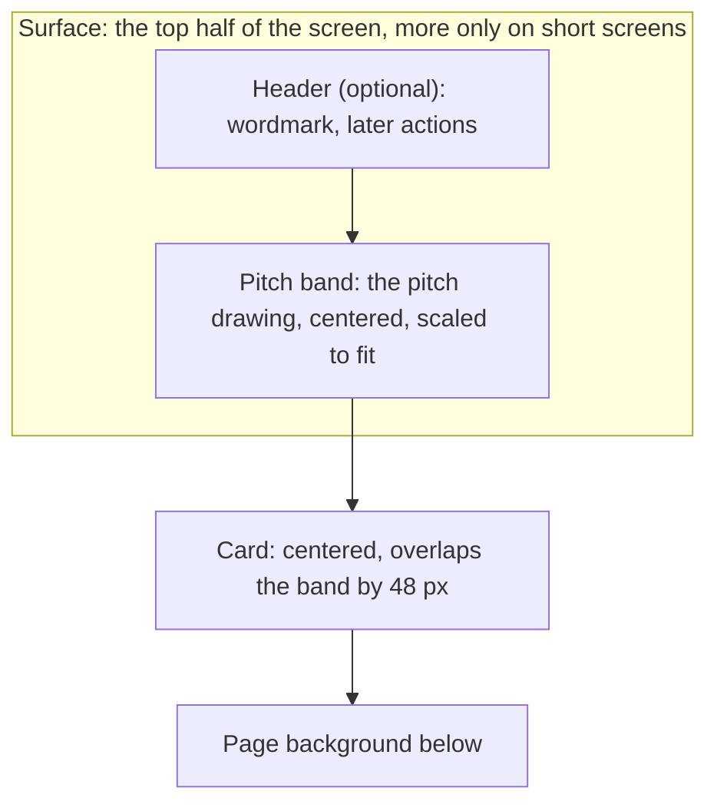

# Design: define the visual identity

Issue: #38 (Task). Branch and change key: `38-visual-identity`.

## Intent

The login Feature's screens need a look to be built from. This change sets the "Night pitch" look once, as theme values and components in code, which are the one source of truth, plus a written design guide that describes them. Every later screen is then consistent. It restyles the placeholder home page as the picture's home screen, and builds the pitch band as a component the login Feature reuses.

The owner picked "Night pitch" from directions explored as Claude Design artifacts. The issue attaches the picture (`night-pitch.png`) and the same screens as standalone HTML (`night-pitch-reference.zip`). The HTML is a reference for layout and the pitch drawing only. Its pixel values were free-hand picks, so they are snapped to Tailwind's defaults (see Values, below). Neither file is a spec.

## Goals

Issue #38's "Done when" list:

- [ ] The chosen direction's picture is committed with the design guide
- [ ] Colors, radius, spacing and both fonts are theme values, and the fonts are self-hosted with `next/font`
- [ ] The home page matches the picture's home screen, with the pitch band as a reusable component
- [ ] The app has a wordmark and a favicon
- [ ] The app name lives in one constant, and the `AGENTS.md` rule names it
- [ ] The `AGENTS.md` Code bullet rules out one-off colors, fonts and spacing
- [ ] The design guide is in `docs/`, has the six parts above, and is linked from the docs index, the how-to guide and `AGENTS.md`
- [ ] The repository owner reviewed the PR's Vercel preview

Only the owner can do the last item, and only once the PR exists. The PR opens with it unticked, and an agent never claims it.

## Non-goals

- No light mode.
- No full logo: just the wordmark and a simple favicon.
- No login screen. The login Feature builds it, reusing the pitch layout and the wordmark. The login's extra colors in the reference HTML (`#C5CDD8` labels, `#6B7686` placeholders, `#E4FF8F` link hover) are not added.
- No Log out button. It comes with the login Feature.
- No change to the design step in the workflow (#39), beyond the links the issue asks for.
- No HTML from the reference zip in the repo.

## Anti-goals

The owner named these. Any of them makes the change a failure, even if it technically works:

- **The pitch is cropped or overflows**, on a narrow phone (360 px wide) or a short screen (a phone in landscape, a short desktop window). It must scale down to fit the band, never shorter than about 96 px, and never touch the card.
- **Volt anywhere else.** Volt (`#C8FF2E`) appears only in the pitch lines, highlighted words and the main button. It is never used for links, focus rings or borders.
- **A flash of the wrong font** while the page loads.
- **The grey not ending at half the screen height.** The surface (header plus pitch band) ends exactly halfway down the screen. The one exception is short screens, such as a phone in landscape: there the pitch's 96 px minimum wins, and the grey grows just enough to fit it (owner's decision).

## Constraints

- **Next.js 16.4.3.** Fonts load through `next/font/google`, which self-hosts them at build time. Per the installed docs (`node_modules/next/dist/docs/01-app/01-getting-started/13-fonts.md`, "With Tailwind CSS"), each font gets a `variable` option, the variables go on `<html>`, and `@theme inline` maps them: `--font-sans: var(--font-inter)`. The favicon uses the `app/icon.svg` file convention.
- **Tailwind CSS 4.3.4 and shadcn/ui (`base-nova`, Base UI).** Tokens follow [shadcn/ui's theming](https://ui.shadcn.com/docs/theming): each token is defined as a CSS variable and exposed to Tailwind through `@theme inline`. In shadcn, `primary` is for high emphasis and `accent` is for hover and focus backgrounds. So volt maps to `primary`, not `accent`.
- **The font trap from #37.** If a theme font variable refers to itself (`--font-sans: var(--font-sans)`), the compiled CSS is invalid and the page falls back to the browser's default font. A green build doesn't catch it. The next/font variables are therefore named after the font (`--font-inter`, `--font-barlow-condensed`), never `--font-sans` or `--font-heading`.
- **The only custom tokens are the colors and the two fonts** (owner's decision). Type sizes, spacing, radius and shadow come from Tailwind's defaults.
- **The screen-design rules in `AGENTS.md`:** no one-off colors, fonts or spacing in screen code. Code generated by `npx shadcn add` is exempt.
- **The issue's correction.** The issue says to "keep `--font-sans` defined in `src/app/globals.css`". #37 removed that line, so this change adds it back, pointing at Inter.

## Values

### Colors

Dark only. All values go in `:root`, written as the issue's hex values. The `.dark` block is deleted. `<html>` gets the `dark` class, so the `dark:` styles in shadcn components (tuned for dark backgrounds) apply, and Tailwind's `scheme-dark` class, so the browser draws scrollbars and form controls dark.

| shadcn token | Value | Notes |
| --- | --- | --- |
| `--background`, `--card` | `#0B0F14` | The page and the cards |
| `--foreground`, `--card-foreground`, `--popover-foreground`, `--secondary-foreground`, `--accent-foreground` | `#F2F5F7` | Text |
| `--popover`, `--secondary`, `--muted` | `#141A22` | Surface. My call for `popover`: it floats over the page, so it takes the lighter surface |
| `--muted-foreground` | `#9AA4B2` | Muted text |
| `--primary` | `#C8FF2E` | Volt |
| `--primary-foreground` | `#0B0F14` | Text on volt |
| `--accent` | `#1B2430` | Hover and focus backgrounds. My call: the divider color shows on both the page and the surface |
| `--border`, `--input` | `#263040` | Borders, input borders |
| `--ring` | `#9AA4B2` | Focus rings. Muted text, not volt (anti-goal) |
| `--destructive` | shadcn's dark value, `oklch(0.704 0.191 22.216)` | The issue gives no error color. Kept until a screen needs errors |

Two new tokens, defined in `:root` and mapped in `@theme inline` as `--color-surface` and `--color-divider`:

| New token | Value | Tailwind class | Use |
| --- | --- | --- | --- |
| `--surface` | `#141A22` | `bg-surface` | The header, the pitch band, inputs |
| `--divider` | `#1B2430` | `border-divider` | The lines under the header and the band |

The `--chart-*` and `--sidebar-*` tokens are deleted, with their `@theme inline` lines (my call). Nothing uses them, and keeping shadcn's greys would leave values the guide doesn't cover. A later change that adds a chart or a sidebar adds them back, with guide rows (the guide's "Need a new value?" rule).

### Fonts

| Font | Loaded with | Variable | Theme token | Use |
| --- | --- | --- | --- | --- |
| Inter | `Inter({ subsets: ["latin"], display: "block", variable: "--font-inter" })`. It's a variable font, so no weight is given | `--font-inter` | `--font-sans: var(--font-inter)` | Everything else |
| Barlow Condensed | `Barlow_Condensed({ weight: "800", style: "italic", subsets: ["latin"], display: "block", variable: "--font-barlow-condensed" })` | `--font-barlow-condensed` | `--font-heading: var(--font-barlow-condensed)` | Headings and the wordmark |

Both variables go on `<html>` with `cn()`, next to `dark` and `scheme-dark`. The `@layer base` rule `html { @apply font-sans; }` stays.

**No flash of the wrong font (my call): `display: "block"` for both fonts.** next/font's default is `swap`, which paints the fallback font first and swaps when the real one arrives. That's the flash the owner named. With `block`, the browser waits briefly for the font before painting the text. Both fonts are self-hosted on the same domain and preloaded in `<head>` (next/font preloads the `latin` subset), so in practice the wait is short. On a very slow connection, the text is invisible for up to about 3 seconds instead of showing in the wrong font. That's the trade this choice makes.

Only Barlow Condensed's 800 italic is loaded, so heading text must always use `italic font-extrabold` with `font-heading`. Otherwise the browser fakes the weight or the slant.

### Type scale

Snapped to Tailwind's defaults (owner's decision). Phone values apply below `md` (768 px); desktop values from `md` up (my call for the breakpoint).

| Kind of text | Classes | Reference px (phone / desktop) |
| --- | --- | --- |
| Page title | `font-heading text-4xl leading-none font-extrabold italic uppercase md:text-6xl` | 38 / 64 |
| Wordmark in the header | `font-heading text-2xl leading-none font-extrabold tracking-wide italic uppercase md:text-3xl` | 26 / 30 |
| Lead text under a page title | `text-sm text-muted-foreground md:text-lg` | 15 / 18 |
| Body text | `text-base` | 16 |
| Small print | `text-xs text-muted-foreground` | 13 |

The login's sizes (wordmark as page title, labels, button) are added to the guide by the login Feature, under its "Need a new value?" rule.

### Radius, spacing and shadow

- **Radius:** `--radius` stays `0.625rem` (10 px), so inputs and buttons use `rounded-lg`. Cards use `rounded-2xl` (18 px on shadcn's derived scale, `radius × 1.8`). Nothing else changes in the radius scale.
- **Spacing:** Tailwind's default scale (4 px steps). The values below are the reference HTML snapped to whole steps.
- **Shadow:** cards use `shadow-2xl`.

## The page layout



### `PitchLayout` (`src/components/pitch-layout.tsx`)

One component renders the whole page frame. It's what the login Feature reuses.

```tsx
<PitchLayout header={<AppHeader />}>
  <Card>…</Card>
</PitchLayout>
```

- **Props:** `header?: ReactNode` (home passes `<AppHeader />`; login passes nothing) and `children` (the card).
- **Root:** `flex min-h-svh flex-col`.
- **Surface:** `flex min-h-[50svh] shrink-0 flex-col bg-surface`. It holds the header (if any) and the band. This one arbitrary value is the only way in Tailwind to say "at least half the viewport height". It isn't a color, font or spacing value. It lives only in this component, and the guide says so, so screens never write it. `svh` (owner's decision), not `dvh`: `dvh` resizes while a phone's address bar slides, which makes the band and the pitch jump on scroll ([WebKit bug 266835](https://bugs.webkit.org/show_bug.cgi?id=266835)). Home and login don't scroll, so the address bar never hides, and for them `svh` and `dvh` are the same: the grey ends at half the screen. It's a minimum, not a fixed height (owner's decision): the surface grows past half only when the header plus the band's minimum height (below) doesn't fit. A fixed `h-[50svh]` with `min-h-min` worked in Chrome, but Safari kept the surface at half, so the band overflowed below the grey and the card covered the pitch.
- **Band:** `relative min-h-44 flex-1 border-b border-divider`. It holds one box, `absolute inset-x-5 top-4 bottom-16 flex items-center justify-center`, over its padded area, and the pitch sits in that box. The box's bottom gap is its top gap (16 px) plus the card's 48 px overlap, so the free space above the pitch equals the free space between the pitch and the card, whatever the band's height.
  - **Why a positioned box (owner's decision):** on a real iPhone in landscape, Safari didn't resolve the pitch's `height: 100%` inside a flex band. The pitch stayed full size, overflowed the band and showed under the card. An absolutely positioned box always has a definite size, so the pitch's `size-full` resolves in every browser. Because the box is out of flow, the pitch also adds nothing to the band's own height.
  - **Minimum pitch size (owner's decision):** `min-h-44` (176 px: a 96 px pitch plus 16 px above and 64 px below) keeps the pitch at least about 96 px tall. Because the surface's height is only a minimum, the grey grows past half only when half the screen is shorter than the header plus 176 px: below about 488 px of screen height on phones (68 px header), about 528 px from `md` up (88 px header), and about 352 px without a header (login). So a phone in landscape and a desktop window under about 528 px get more grey. Every taller screen gets exactly half.
- **Pitch drawing:** the `<Pitch />` SVG, sized `block size-full max-h-57 max-w-92 overflow-visible`. `overflow-visible` keeps the outer half of the 2 px lines from being clipped when the drawing scales down, since the viewBox leaves only 1 unit of margin. Its viewBox fits the drawing exactly (`11 7 368 228`: the field plus goals and line width), so at full size it's 368 × 228 px, as in the reference at 390 px. `preserveAspectRatio` stays at its default (`xMidYMid meet`), so the drawing scales down uniformly to fit both the box's width and its height, stays centered, and is never cropped. It's never shorter than about 96 px (see Band), and it never overflows.
- **Card slot:** `relative -mt-12 flex justify-center px-5 pb-8`. `-mt-12` is the 48 px overlap. `relative` paints the card above the band. Phone side margins are 20 px (`px-5`). The card sets its own width (home: `w-full md:max-w-160`, 640 px).

### `Pitch` (`src/components/pitch.tsx`)

The reference's SVG, ported as is: field, halfway line, center circle, both penalty areas, goal areas, penalty arcs, goals, corner arcs, center spot and penalty spots. It's decorative: `aria-hidden="true"`.

- Lines: `fill-none stroke-primary/70` with `strokeWidth={2}` and `vectorEffect="non-scaling-stroke"`, so lines stay 2 px wide when the drawing scales down.
- Spots: `fill-primary/70`.
- The 70% opacity is from the reference, written with Tailwind's opacity modifier. No hex in the component.

### `AppHeader` (`src/components/app-header.tsx`)

`flex h-17 shrink-0 items-center justify-between border-b border-divider px-5 md:h-22 md:px-16`, holding the `Wordmark` as a `<p>` (it isn't the page title; the card's heading is). The surface color comes from `PitchLayout`. The login Feature adds the Log out button to its right side, so it takes `children` for actions (empty for now).

### `Wordmark` (`src/components/wordmark.tsx`)

The app name in the header style above, with its second part in `text-primary`. Accepts `className` (to resize it; the login Feature makes it its page title) and an `as` prop for the element (`p` by default). The text is the name as written, `SquadHopper`, and CSS uppercases it, so screen readers read the name, not letters.

## App name

`src/lib/app-name.ts`:

```ts
export const APP_NAME_PARTS = ["Squad", "Hopper"] as const;
export const APP_NAME = APP_NAME_PARTS.join("");
```

The wordmark needs the split, and the title needs the whole name. Both come from one line, so a rename touches one place in the code (my call on the shape). `metadata.title` in `src/app/layout.tsx` becomes `APP_NAME`. The `AGENTS.md` rule becomes: "Its name appears only in the `README.md` title and in `src/lib/app-name.ts`."

## Home page

`src/app/page.tsx`:

```tsx
<PitchLayout header={<AppHeader />}>
  <Card className="…">
    <h1>All your matches{" "}<br />in <span className="text-primary">one place.</span></h1>
    <p>Every team and every tournament on one calendar.</p>
  </Card>
</PitchLayout>
```

- **Card:** shadcn's Card, added with `npx shadcn add card` (the first screen that needs it), left as generated. The page restyles it through `className`: `w-full items-center gap-4 rounded-2xl border border-border bg-card px-6 pt-8 pb-9 text-center shadow-2xl md:max-w-160 md:px-12 md:pt-10 md:pb-11`. The builder adds whatever is needed to cancel Card's own defaults (for example its ring or padding), using theme classes only. Only `Card` is used, not `CardTitle`, because the heading must be an `<h1>`.
- **Heading:** page title style. The line break matches the picture. The `{" "}` before `<br />` keeps the heading's text "All your matches in one place.", with its space, for screen readers and tests. "one place." is the only volt text.
- **Text:** lead text style.
- "Coming soon" is removed, and `metadata.title` is the app name.

## Favicon

`src/app/icon.svg`: a 32 × 32 rounded square in surface (`#141A22`), with a small pitch in volt lines (field outline, halfway line, center circle). It uses the palette's hex values, since an SVG file can't read CSS variables. The pitch lines are an allowed use of volt. Next.js adds the `<link rel="icon">` itself.

## The design guide

`docs/reference/design-guide.md`, in a new Diátaxis **Reference** section (`docs/reference/README.md`, linked from the docs index table). It describes `globals.css` and the components, which stay the source of truth: if the guide and the code ever disagree, the code wins and the guide gets fixed. It's written for people first, so someone can build a screen without reading the code. Agents read the same page. Parts, in order:

1. **Tokens table:** name, value, Tailwind class, and when to use it. Every color token from Values above, plus the two fonts and the radius. Volt's row states the rule: pitch lines, highlighted words and the main button only, never links, focus rings or borders.
2. **Type scale table:** the classes for each kind of text, as above.
3. **Page layout in words**, with the short `PitchLayout` example and the rules: the surface ends at half the screen except on short screens, the card overlaps 48 px, the pitch scales to fit, is never shorter than about 96 px, and never touches the card. It notes that `min-h-[50svh]` lives only in `PitchLayout`, why it's a minimum (so the surface can grow on short screens in Safari too), and why it's `svh` (the band and pitch don't jump while a phone's address bar slides).
4. **Do and don't**, each with a one-line reason. For example: `text-primary`, not `text-[#C8FF2E]` or `text-lime-400`; `text-4xl`, not `text-[38px]`; `rounded-2xl` on cards, not `rounded-[20px]`; `border-border` or `border-divider`, never `border-primary`; `text-foreground underline` for links, not `text-primary`; `font-heading italic font-extrabold`, never `font-heading` alone.
5. **"Need a new value?":** add the token to `globals.css` and a row to this guide in the same PR.
6. **The picture**, `docs/reference/night-pitch.png`, committed as the before-code reference. A note says it records the look, not any screen's spec ([ADR 0013](../explanation/decisions/0013-design-screens-in-code.md)), and that its pixel sizes were snapped to Tailwind's scale, so the code wins where they differ.

Links to the guide, as the issue asks:

- `docs/README.md`: a Reference row in the Contents table.
- `docs/how-to/development-workflow.md`: step 3 of Screen design ("Build from the design system").
- `AGENTS.md`: the Screen design section's "Build from the design system" bullet.

## `AGENTS.md` changes

- **General:** the name rule names `src/lib/app-name.ts` (see App name).
- **Code:** the Tailwind bullet becomes "Style with Tailwind classes and the theme variables in `src/app/globals.css`, with no one-off colors, fonts or spacing." The rest of the bullet stays.
- **Screen design:** a link to the design guide.

## ADR

Add **ADR 0014, "Ship one dark theme"**, in this PR, and list it in the index. It's named after the decision (owner's decision). Choosing one dark theme, instead of shadcn's light and dark pair, is a real choice. It's costly to undo, since every later screen is checked only against dark, and someone will ask why. The ADR's context is the Night pitch direction, picked from the Claude Design explorations, whose dark surface and volt accent are the reason for going dark only. It records that `globals.css` and the components are the one source of truth, as ADR 0012 says, and that the design guide describes them. It relates to ADRs 0012 and 0013.

## Tests

Unit tests, in `__tests__/` folders next to the code (Vitest and Testing Library, as today):

- `src/app/__tests__/page.test.tsx` (rewritten): the `h1` reads "All your matches in one place."; "one place." is in an element with `text-primary`; the lead text is there; the wordmark shows the app name; "Coming soon" is gone; no links.
- `src/components/__tests__/pitch-layout.test.tsx`: renders the header when given and not when omitted; renders the children; the pitch drawing is `aria-hidden`; the pitch sits in the absolutely positioned box over the band's padded area; the band has `min-h-44`; the surface has `min-h-[50svh]`, with no fixed height or `min-h-min`. (jsdom has no layout, so these pin the structure; the sizes themselves are checked on the preview.)
- `src/components/__tests__/wordmark.test.tsx`: the text is `APP_NAME`; only the second part has `text-primary`; `as` changes the element.
- `src/components/__tests__/app-header.test.tsx`: shows the wordmark and any children.
- `src/lib/__tests__/app-name.test.ts`: `APP_NAME` is the parts joined.
- `src/app/__tests__/layout.test.tsx`: `metadata.title` is `APP_NAME`. `next/font/google` is mocked, since it only works inside the Next.js build.

Volt's limited use isn't fully testable in unit tests. A check in the plan searches `src/` for `primary` and confirms each hit is a pitch line, a highlighted word or a main button.

## Checks beyond the tests

- `npm test`, `npm run lint`, `npm run typecheck`, `npm run format:check` and `npm run build` pass. Run `npm run format` after `npx shadcn add card`.
- **The compiled-CSS check from #37, re-run:** in the built CSS under `.next/static/`, neither `--font-sans` nor `--font-heading` refers to itself. The `font-sans` and `font-heading` utilities resolve to `var(--font-inter)` and `var(--font-barlow-condensed)`, and next/font's CSS defines those as stacks starting with `Inter` and `Barlow Condensed`.
- **No one-off values in screen code:** no `[` arbitrary values in the classes written for this change, except `min-h-[50svh]` in `PitchLayout`. No hex colors in `src/` outside `globals.css` and `icon.svg`. No palette classes like `lime-` or `slate-`.
- **The layout at these sizes, from `npm run dev`:** 360 × 640, 390 × 844, 844 × 390 (phone landscape), 768 × 1024, 1280 × 800 and 1280 × 500. At each: the grey ends at half the screen height, except at 844 × 390 and 1280 × 500, where it grows just enough to keep the pitch about 96 px tall. The pitch is whole, centered, with equal space above it and between it and the card, and it doesn't touch the card. Check 844 × 390 on a real iPhone in Safari too.
- **Screenshots** at 390 px and 1280 px for the PR. This machine has no browser an agent can already drive, so unless one turns up, the owner captures them from a local run or the preview (as `AGENTS.md` allows). The layout check above then also falls to the owner, on the preview.

## Left to the builder

- Exact SVG markup of the pitch, as long as it matches the reference drawing and the viewBox fits the drawing.
- The favicon's exact geometry.
- How the Card's generated defaults are cancelled, using theme classes only.
- Commit boundaries, file order, and the guide's wording.
